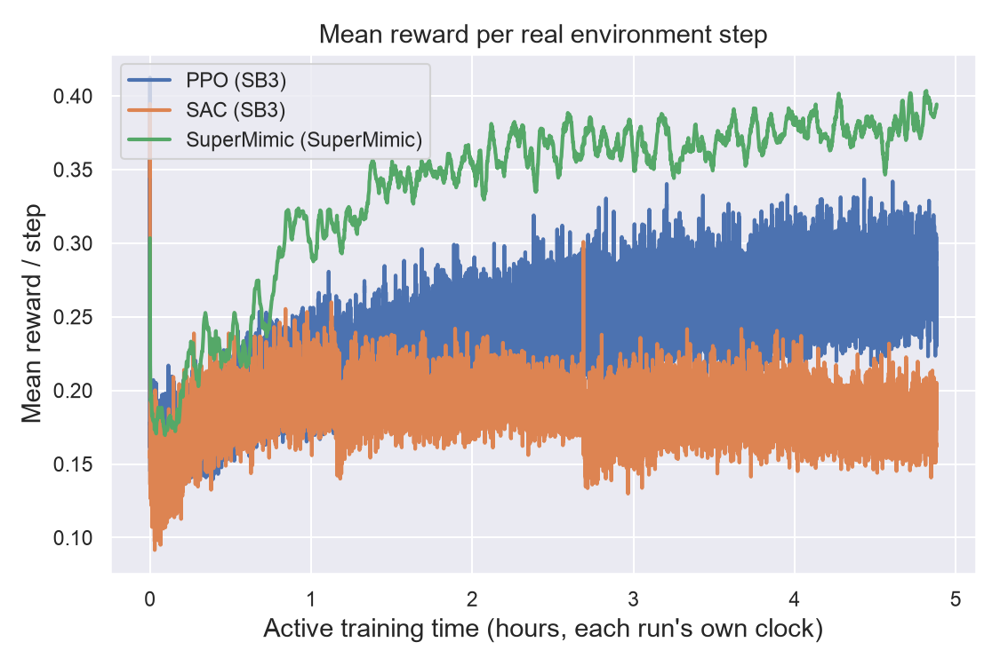

# legged-robot

A custom 12-DoF quadruped ("OD"), simulated in PyBullet, trained to track reference motion-capture
gaits (pace/trot/gallop/turn/idle + a get-up-from-a-fall recovery task) via DeepMimic-style
imitation reward. Two independent training paths live side by side for comparison:

- **Legacy PPO/SAC** (`quadruped_envs/train.py`/`enjoy.py`), via a vendored rl-baselines3-zoo
  harness -- the project's original 2021 approach.
- **SuperMimic port** (`quadruped_envs/supermimic/`) -- a from-scratch port of
  *SuperMimic: Scaling Humanoid Whole-Body Control with One Differentiable World Model*
  (world model + BPTT over imagined rollouts instead of policy-gradient on real rollouts),
  replacing GPU-cluster-scale parallelism with ~16 real PyBullet CPU workers.

Both now share the same reward function and PD position-control actuator model by default, so
training speed/quality between them is directly comparable (see "Comparing PPO/SAC vs
SuperMimic" below).

## Setup (macOS / Apple Silicon)

    brew install python@3.11   # if not already installed
    ./tools/setup_env.sh

The pinned deps in `requirements.txt` are from 2021 (Linux/x86) and won't install as-is on a
modern Mac; this script builds a `.venv` with modern arm64-native versions instead, builds
`motion_imitation`/`pybullet` from source with two small compatibility patches (`patches/`,
needed because their vendored/compiled code predates recent macOS SDKs and Python versions),
and smoke-tests `OpenDynamicImitationEnv-v0`. Activate with `source .venv/bin/activate`.

## Legacy PPO/SAC baseline

An rl-baselines3-zoo harness at `quadruped_envs/train.py`/`enjoy.py` -- **must run with
`quadruped_envs/` as the working directory** (that's where the sibling `utils/` package
resolves from); the plotting scripts live at the repo root instead. Needs
`stable-baselines3==1.8.0`/`sb3_contrib==1.8.0` (pinned in `requirements.txt` -- the last
versions built against classic `gym==0.21`, matching this project's pin exactly).

    cd quadruped_envs

    # Train ppo/sac for 1,000,000 steps, checkpointing every 100,000:
    ../.venv/bin/python3 train.py --algo ppo --env OpenDynamicImitationEnv-v0 -n 1000000 --save-freq 100000 --env-kwargs render:False
    ../.venv/bin/python3 train.py --algo sac --env OpenDynamicImitationEnv-v0 -n 1000000 --save-freq 100000 --env-kwargs render:False

    # Watch the best checkpoint from the 1st ppo experiment (opens a live PyBullet window):
    ../.venv/bin/python3 enjoy.py --algo ppo --env OpenDynamicImitationEnv-v0 -f logs/ --exp-id 1 --load-best \
      --env-kwargs render:True 'motion_names:"pace,trot"' -n 200000

    cd ..
    # Plot training curves (repo root; note the path to quadruped_envs/logs/):
    .venv/bin/python3 -m scripts.plot_train --algo ppo --env OpenDynamicImitationEnv-v0 -f quadruped_envs/logs/
    .venv/bin/python3 -m scripts.all_plots --algos ppo sac --env OpenDynamicImitationEnv -f quadruped_envs/logs/

`--env` must be `OpenDynamicImitationEnv-v0` (the id registered in `quadruped_envs/__init__.py`).
Hyperparameters (network size, learning rate, etc.) come from `quadruped_envs/hyperparams/
{ppo,sac}.yml`, not CLI flags.

**`sac.yml`'s `n_envs` was missing (defaulted to 1), fixed to `8` (matching `ppo.yml`)**: SAC was
running fully serial real-env collection, never tuned for parallel data gathering. **This alone
is NOT enough** -- `exp_manager.py` defaults to `DummyVecEnv` (sequential env-stepping inside one
process, not real multi-core parallelism), and SAC's per-step train loop (`train_freq=1`) pays
that sequential-stepping cost on every single round, unlike PPO which amortizes it over a large
batched rollout. A short smoke test with just the `n_envs` fix looked good (~960-1000 fps) but
that was an early transient -- the real steady-state (confirmed over 730k real steps) settled
back down to ~252-256 fps, barely better than before. **Pass `--vec-env subproc`** to actually
get separate OS processes for each env (confirmed stable at ~1100-1200 fps over a 150k-step
test, a genuine ~4.4x gain that holds). Both flags are needed together for a fair comparison
against PPO's own effectively-parallel throughput.

**`enjoy.py`'s `-n`/`--n-timesteps` is a literal step count, not "0 = run forever"** (unlike
`demo_live.py`'s `--steps 0` convention) -- `-n 0` opens the window and closes it immediately
(`for _ in range(0)`). Pass a real number (e.g. `200000`) to keep the window open for a while.
Also pass the **same `motion_names`** the checkpoint was actually trained with (e.g.
`'motion_names:"pace,trot"'`) -- otherwise it silently falls back to the single-gait default,
which still runs but doesn't show what the policy was actually trained to do.

**Defaults match the SuperMimic port**, for a genuine side-by-side comparison:
`OpenDynamicImitationEnv.__init__` defaults to `control_mode="position"` (PD position control,
same underlying `motion_imitation` mechanism the SuperMimic side uses) with the policy-facing
action range narrowed to `±0.3125` rad (`ACTION_POS_SCALE`, imported directly from
`supermimic/mdp.py` so the two sides can't drift apart -- a strict subset of the library's
native `±1` rad bound, never causes an out-of-range error) and `action_rate_weight=0.05` (same
action-rate penalty formula as `mdp.py`'s `action_rate_penalty`: mean squared per-joint action
change between consecutive steps, subtracted from the reward). Reward term weights/scales were
already identical between `imitation_task.py` and `mdp.py`'s `compute_reward` (pose 0.35 /
velocity 0.15 / end-effector 0.2 / root-pose 0.2 / root-velocity 0.05) -- control mode and the
action-rate penalty were the only gaps, now closed.

To restore the original torque-control-only baseline instead:
`--env-kwargs 'control_mode:"torque"' action_rate_weight:0` (the quoting is `StoreDict`'s own
convention -- each value is `eval()`'d, so a string needs its own quotes inside the
shell-quoted argument).

**`motion_names`** (default `"pace"`, matching the original single-gait behavior): comma-
separated motion basenames to train on jointly -- `ImitationTask` already natively supports a
motion list with uniform-random per-episode sampling (the same mechanism SuperMimic's own real
workers use via `build_imitation_env`), it just was never exposed as more than one hardcoded
file on this env class. For a fair comparison against a SuperMimic run trained on the same
motion set:

    --env-kwargs render:False 'motion_names:"pace,trot"'

## SuperMimic port (world-model + BPTT, CPU/MPS)

Lives entirely under `quadruped_envs/supermimic/`. Activate the venv first:
`source .venv/bin/activate`.

#### Continue training a run

    python3 -m quadruped_envs.supermimic.train \
      --resume quadruped_envs/supermimic/logs/<run_name>/last.pt \
      --device mps --num_envs 16 --iterations 50000 --lr_decay_iters 40000 --wm_only_iters 50 \
      --warmup_steps 64 --buffer_steps 2000 --wm_batch 128 --pi_batch 128 --horizon 12 --wm_batches 3 \
      --action_noise 0.02 --log_every 10 --ckpt_every 50 \
      --motion_file "quadruped_envs/data/motions/od/pace.txt,quadruped_envs/data/motions/od/trot.txt,quadruped_envs/data/motions/od/gallop.txt,quadruped_envs/data/motions/od/turn.txt,quadruped_envs/data/motions/od/idle.txt" \
      --log_dir quadruped_envs/supermimic/logs/<run_name>

`--resume` must point at that same run's `last.pt`; other flags should match the original launch
(they aren't restored from the checkpoint). `--motion_file` takes a comma-separated list to
train jointly across several gaits (`motion.py`'s `MultiMotion`); pass a single path to train on
one gait only. Drop `--device mps` for `--device cpu`. To start a brand-new run, drop `--resume`
and pick a fresh `--log_dir`.

**The exact flags a checkpoint was trained with are saved inside it**, under `ck["args"]` --
more reliable than any example here, since hyperparameters get tuned across sessions:

    python3 -c "import torch; print(torch.load('<ckpt.pt>', map_location='cpu', weights_only=False)['args'])"

**Launching long runs:** use `launchctl submit`, not `nohup ... & disown` -- a terminal tab
embedded in an IDE can die (and take `nohup` jobs with it) when the IDE closes. See the
`background_process_survival_macos` memory for the exact invocation; `launchctl submit` jobs can
silently restart after a clean exit, so `launchctl remove <label>` once a run hits its target
iteration count.

#### Algorithm features (beyond the base world-model + BPTT port)

All additive/optional via CLI flags unless noted -- a checkpoint saved with a flag off still
loads fine if later turned on (and vice versa, for anything that's a reward/physics change
rather than a network-shape change):

- **`--learned_termination`**: paper's learned termination head instead of a hand-tuned analytic
  formula. Network capacity is always present; gated by its own accuracy (`--term_warmup_acc`,
  default 0.95) before use, then blended in over `--term_blend_iters`.
- **Sim-context ξ** (friction + per-joint action-space offset randomization): always active, not
  a flag -- baked into observation/network shapes (`mdp.py`'s `XI_DIM`), so pre-ξ checkpoints are
  incompatible (shape mismatch).
- **`--critic_loss huber` / `--critic_lr_scale` / `--critic_value_clip`**: critic stability fix
  (Huber loss, a lower LR than wm/pi, a hard value clamp) -- needed because the critic can
  diverge under hard-gait-concentrated data without these.
- **Action-rate penalty** (`mdp.py`'s `ACTION_RATE_WEIGHT`): always active -- quadratic penalty
  on frame-to-frame action change, pushing the policy toward smoother commands.
- **Joint armature** (`od_gym_env.py`'s `ARMATURE_INERTIA`): always active -- adds reflected
  motor/gearbox rotor inertia per leg joint (PyBullet has no native URDF support for this). A
  real dynamics change: old checkpoints still load but were trained under different physics.
- **`--compile`**: wraps hot-path tensor ops in `torch.compile()`. Works (incl. on MPS),
  checkpoint-compatible, only ~5-10% iteration-speed gain -- off by default.
- **`--control_mode {torque,position}`** (default `torque` here; `position` is what every
  currently-live run actually uses): `position` switches to PD control, action = small offset
  from a per-motion target pose (`mdp.py`'s `ACTION_POS_SCALE`/`DEFAULT_Q`/`RECOVERY_Q_*`).
  **A real dynamics change -- a checkpoint trained under one mode is not resumable under the
  other** (loads fine shape-wise, but the action->dynamics mapping is wrong); start fresh when
  switching. `demo_live.py`/`diagnose_rollout.py` read the checkpoint's own saved mode and
  convert correctly either way.
- **Bin-sampling's "keep" term** (`env.py`'s `TrackingSim._push_bin_probs`): ported from the
  official SuperMimic repo's `ReturnSampler` -- a cumulative sum of squared softmax-focus
  (`effort`) rather than an EMA, so a bin that was heavily practiced while hard keeps earning
  practice even after its value improves and focus moves elsewhere.
- **Checkpoint retention** (`--ckpt_keep_recent`/`--ckpt_milestone_every`, default 20/1000):
  numbered `ckpt_NNNNNN.pt` snapshots are pruned after every save, keeping only the most recent
  N plus every Mth iteration forever. `last.pt` (what `--resume` reads) is never touched.

#### Recovery (getting up from a fall)

`quadruped_envs/data/motions/od/recovery.txt` is a reference-free task (literally a copy of
`idle.txt` -- the target is just "stand still"): episodes sometimes start from a scripted
fallen-on-its-back pose, hard-fail termination is suppressed for it, and a dense "upright-ness"
shaping reward (`mdp.py`'s `recovery_progress_reward`) guides the policy toward standing back up
(the normal tracking reward gives ~zero signal from ~180 degrees misaligned).

    --recovery_motion quadruped_envs/data/motions/od/recovery.txt \
    --recovery_init_prob 0.9 --recovery_sample_prob 0.1

`--recovery_sample_prob` reserves a fixed fraction of resets for recovery independent of
ordinary return-weighted bin-sampling (and `env.py`'s `_recovery_bin_mask` excludes recovery's
own bins from that softmax) -- without this, recovery's persistently-low return causes
bin-sampling to give it an ever-growing share of resets as other gaits improve, which
catastrophically forgets them within ~1000 iterations. ~0.08-0.12 gives recovery meaningful
practice without that runaway. `--recovery_init_prob` (within that reserved share) sets how
often it starts fallen vs. standing.

Under `--control_mode position`, recovery also needs a much wider commandable joint-angle range
than ordinary gaits (`mdp.py`'s `RECOVERY_Q_CENTER`/`RECOVERY_Q_HALF_RANGE`, applied
automatically) -- the ordinary narrow range cannot represent a self-righting push-off from flat
on the back.

**Status (2026-11-13): trains stably, but the robot does not yet actually stand up.** It
reliably tumbles/flails its orientation through near-vertical, but root height and joint pose at
that moment are nowhere close to real standing (confirmed via `diagnose_rollout.py`'s
instrumentation, not eyeballing) -- a momentary tumble-through, not a controlled stand. Plateaued
at this level across many checks.

A more general alternative, `--adaptive_distress` (see `env.py`'s module docstring), ties the
same wide-range/no-termination treatment to measured tracking failure during any gait instead of
only this one file. **Not ready to use yet**: an earlier version let the policy exploit
termination-immunity + a dense shaping reward to just stay "distressed" forever; the shaping
bonus has since been restricted to the file-based recovery task only, and a fraction of real
transitions still gets flagged distressed at a rate (~75-80%) that isn't yet understood or
validated as correct -- treat this flag as experimental.

To just watch/test recovery without training, pass
`--motion_file .../recovery.txt --recovery_init_prob 1.0` to force every reset fallen.

#### Watch a trained checkpoint live

Opens a real PyBullet GUI window on screen:

    python3 -m quadruped_envs.supermimic.demo_live \
      --ckpt quadruped_envs/supermimic/logs/pd_full_run1/last.pt \
      --motion_file "quadruped_envs/data/motions/od/pace.txt,quadruped_envs/data/motions/od/trot.txt,quadruped_envs/data/motions/od/gallop.txt,quadruped_envs/data/motions/od/turn.txt,quadruped_envs/data/motions/od/idle.txt" \
      --recovery_motion quadruped_envs/data/motions/od/recovery.txt

**Requires `.venv/bin/python3`** (or an activated venv) -- plain `python3` fails with
`ModuleNotFoundError: No module named 'gym'`. `--motion_file` takes a comma-separated list
(quote it) and drives interactive controls in the window:

- **N / P** -- switch to the next/previous gait live, with **no reset**: only the reference
  target changes, the robot's physical state is untouched, so you can watch the policy "catch" a
  new reference mid-stride.
- **R** -- force a full reset (fallen pose if `--recovery_motion` was given, otherwise an
  ordinary reference-synced reset).
- On-screen status text is parented to the robot's base link so it travels with the robot
  instead of drifting as it moves/falls.

`--recovery_motion` is auto-appended to `--motion_file` if missing, and excluded from ordinary
N/P cycling. `--steps 0` runs until the window closes (Ctrl+C also exits cleanly); `--steps N`
(default 4000) stops after N steps. `--no_reset` disables resetting on a fall/drift/episode-end,
for watching contact/impact behavior over a long continuous stretch.

**Don't use `--urdf_filename quadruped_envs/urdf/od_capsule_debug.urdf` for normal viewing** --
it swaps the robot's visual mesh for thin collision-matching capsules, useful only for checking
capsule placement; it makes ordinary residual joint jitter look far more erratic than it really
is on the normal mesh body.

#### Other evaluation scripts

    # Save a rollout to a GIF instead of a live window (for sharing/artifacts)
    python3 -m quadruped_envs.supermimic.eval_policy_rollout --ckpt <ckpt.pt> --motion_file <motion.txt> --out rollout.gif

    # Measure real displacement/fall-rate/foot-slip instead of eyeballing it
    python3 -m quadruped_envs.supermimic.diagnose_rollout --ckpt <ckpt.pt> --motion_file <motion.txt> --steps 600

## Comparing PPO/SAC vs SuperMimic

    # SuperMimic-only training curves (reward, wm_loss, imag_reward, survival, v_loss):
    python3 -m scripts.plot_supermimic_train \
      --run quadruped_envs/supermimic/logs/pd_full_run1:pd_full_run1 \
      --x-axis steps --y-axis reward

    # Overlay PPO/SAC (SB3 Monitor data) against SuperMimic (train_log.csv):
    python3 -m scripts.compare_training_speed \
      --sb3 quadruped_envs/logs/ppo/OpenDynamicImitationEnv-v0_1:PPO \
      --sb3 quadruped_envs/logs/sac/OpenDynamicImitationEnv-v0_1:SAC \
      --supermimic quadruped_envs/supermimic/logs/pd_full_run1:SuperMimic \
      --x-axis steps   # or --x-axis time for wall-clock hours

**Continuing an SB3 run with `train.py --trained-agent <ckpt>.zip` always starts a brand-new
numbered experiment directory** (`exp_manager.py`'s own convention, even for the same algo/env --
it never resumes writing into the previous one), so its Monitor clock/step-count would otherwise
reset to zero and the comparison chart would look like a short, disconnected second run. Stitch
them back into one continuous series by comma-separating the dirs within a single `--sb3` value:

    --sb3 "quadruped_envs/logs/sac/OpenDynamicImitationEnv-v0_1,quadruped_envs/logs/sac/OpenDynamicImitationEnv-v0_2:SAC"

Each listed dir is re-anchored to its own start and concatenated with zero gap from the previous
one (the real-world pause between stopping one chunk and starting the next is exactly the kind of
dead time `--collapse-stalls` already excludes elsewhere, so this is consistent, not a special
case). `--supermimic` doesn't need this -- `train.py`'s own `--resume` appends to the same
`train_log.csv` in place.

Both plot mean reward **per real environment step**: SB3's Monitor logs an episodic return, so
`compare_training_speed.py` divides by episode length to land in the same per-step unit
SuperMimic's `train_log.csv` already logs directly. Since both sides now share the same reward
weights and default `control_mode="position"` (see above), this is a genuine apples-to-apples
comparison as long as neither side's `--env-kwargs`/`--control_mode` has been overridden away
from the shared defaults.

**`--x-axis time` plots each run's own active training duration** (`compare_training_speed.py`
only -- `plot_supermimic_train.py` has no cross-run alignment problem since every run it plots is
the same kind of source), starting every curve at x=0 regardless of when it was actually launched
-- when one run happened to start later in real time doesn't matter here, only how much real
wall-clock it itself consumed. SB3's Monitor header stores each run's actual start as a Unix
timestamp (`sb3_abs_start()`), and a SuperMimic run's start is recovered from its log file's own
mtime minus its last logged `wall_h` (`supermimic_abs_start()`, `scripts/_plot_utils.py`) -- both
work even after the process has exited.

**Abnormal stalls are excised from that duration, on by default**: a macOS sleep/DarkWake event
can freeze wall-clock progress for hours while barely advancing any run (confirmed to happen even
on AC power, not just battery -- see `background_process_survival_macos` project memory) -- left
in, that dead stretch both inflates "how long this run took" and squashes the rest of the curve
into an unreadable sliver. `build_shared_warp()` (`scripts/_plot_utils.py`) computes ONE
gap-capping transform from the UNION of every series' absolute timestamps (caps any gap above
`--stall-factor`, default 3, times the typical combined spacing), applies it identically to all
of them, THEN each series is re-anchored to its own warped start. The identical shared transform
matters even though every run gets its own x=0: a stall that actually hit several runs at the
same real moment must shrink every one of their durations by the same amount, or two runs that
ran for the same real active time end up different lengths on the chart for no reason -- and a
run launched only after the stall had already ended (relaunched SAC, here) correctly shows zero
stall time subtracted, since it never experienced one. Two confirmed-wrong earlier attempts, in
order: (1) each series compressing its own gaps independently, which let a shared stall shrink by
different amounts on different curves; (2) aligning everyone to one shared calendar clock instead
of each run's own start, which made a run's later launch time look like it had "run less so far,"
when launch time isn't the thing being compared. Pass `--no-collapse-stalls` to see each run's
raw, own-start-anchored walltime instead (e.g. to confirm a stall actually happened and see how
long it really was).

**`--clip-to-shortest` trims every curve to the shortest series' own final x value**, so all
curves end at the same point instead of some just running on past where the others stop --
without it, a shorter run's flat ending next to a much longer run's continuing curve reads as
"and then it just gives up," which isn't the claim being made:

    python3 -m scripts.compare_training_speed \
      --sb3 quadruped_envs/logs/ppo/OpenDynamicImitationEnv-v0_1:PPO \
      --sb3 "quadruped_envs/logs/sac/OpenDynamicImitationEnv-v0_1,quadruped_envs/logs/sac/OpenDynamicImitationEnv-v0_2:SAC" \
      --supermimic quadruped_envs/supermimic/logs/pace_trot_compare:SuperMimic \
      --x-axis time --clip-to-shortest --out docs/training_speed_comparison.png

#### Result: pace+trot, matched reward/control-mode, active time only

SuperMimic (green) reaches a reward/step plateau around ~0.35-0.40 within roughly the first hour
of its own active training time; PPO (blue) climbs more slowly toward ~0.25-0.3 and SAC (orange)
settles lowest, around ~0.18-0.22 -- neither catches SuperMimic within the window shown. This
isn't just "SAC undertrained": SAC's own curve (stitched across a 20M-step run plus a 32M-step
`--trained-agent` continuation, see above) was deliberately extended to **7.0 active hours and
52M real environment steps total -- more of both than either PPO (5.0h / 35.3M steps) or
SuperMimic (4.7h / 870k steps) used** -- and it still plateaus lowest of the three at a peak of
~0.30. SuperMimic's own real-step count is two orders of magnitude smaller than either SB3
algorithm's, because most of its learning comes from imagined BPTT rollouts through its own
world model rather than real experience -- the paper's central claim, measured here rather than
assumed.

**Caveats, so this number isn't over-claimed**: reward weights, `control_mode`, termination, and
episode curriculum are confirmed identical between the two codebases (see above); two asymmetries
remain and were not eliminated -- PPO/SAC run on CPU because the pinned `stable-baselines3==1.8.0`
has no MPS/GPU code path at all, while SuperMimic uses `--device mps` (not fixable without a
riskier library upgrade); SuperMimic's real workers also apply sim-context domain randomization
(friction/joint-offset) that the legacy env never does, making SuperMimic's task strictly harder,
not easier. This is a practical comparison of two codebases as actually configured, not a
controlled ablation -- treat the direction of the result (SuperMimic faster and reaching a higher
plateau) as solid, and the exact multiplier as illustrative rather than precise.
